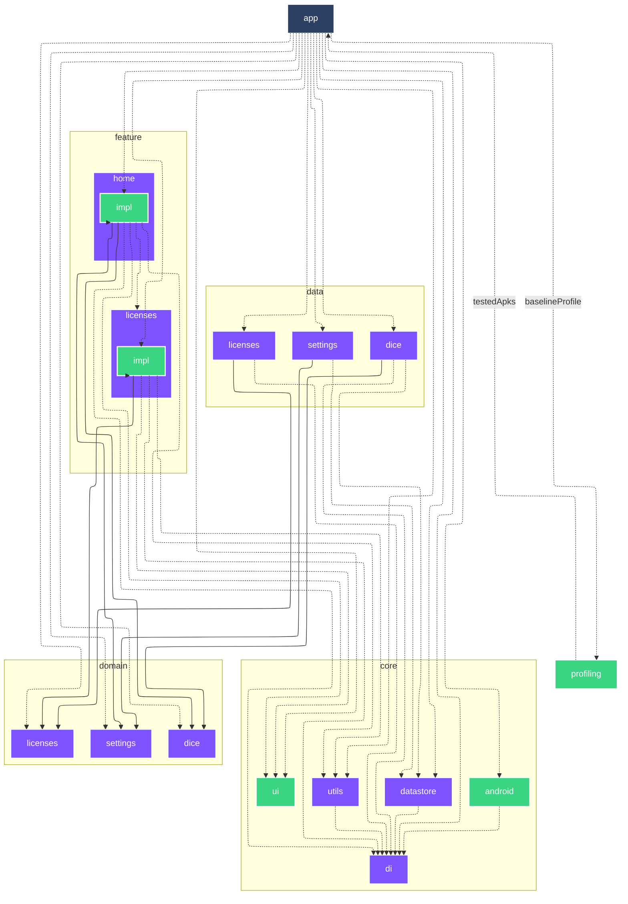

# `:profiling`

<!--region graph-->
> [!TIP]
> [✨ View in `mermaid.live`](https://mermaid.live/view#base64:eyJjb2RlIjoiLS0tXG5jb25maWc6XG4gIGxheW91dDogZWxrXG4gIGVsazpcbiAgICBub2RlUGxhY2VtZW50U3RyYXRlZ3k6IFNJTVBMRVxuLS0tXG5ncmFwaCBUQlxuICBzdWJncmFwaCA6Y29yZSBbY29yZV1cbiAgICBkaXJlY3Rpb24gVEJcbiAgICA6Y29yZTphbmRyb2lkW2FuZHJvaWRdOjo6YW5kcm9pZC1saWJyYXJ5XG4gICAgOmNvcmU6ZGF0YXN0b3JlW2RhdGFzdG9yZV06Ojpqdm1cbiAgICA6Y29yZTpkaVtkaV06Ojpqdm1cbiAgICA6Y29yZTp1aVt1aV06OjphbmRyb2lkLWxpYnJhcnlcbiAgICA6Y29yZTp1dGlsc1t1dGlsc106Ojpqdm1cbiAgZW5kXG4gIHN1YmdyYXBoIDpkb21haW4gW2RvbWFpbl1cbiAgICBkaXJlY3Rpb24gVEJcbiAgICA6ZG9tYWluOmRpY2VbZGljZV06Ojpqdm1cbiAgICA6ZG9tYWluOmxpY2Vuc2VzW2xpY2Vuc2VzXTo6Omp2bVxuICAgIDpkb21haW46c2V0dGluZ3Nbc2V0dGluZ3NdOjo6anZtXG4gIGVuZFxuICBzdWJncmFwaCA6ZGF0YSBbZGF0YV1cbiAgICBkaXJlY3Rpb24gVEJcbiAgICA6ZGF0YTpkaWNlW2RpY2VdOjo6anZtXG4gICAgOmRhdGE6bGljZW5zZXNbbGljZW5zZXNdOjo6anZtXG4gICAgOmRhdGE6c2V0dGluZ3Nbc2V0dGluZ3NdOjo6anZtXG4gIGVuZFxuICBzdWJncmFwaCA6ZmVhdHVyZSBbZmVhdHVyZV1cbiAgICBkaXJlY3Rpb24gVEJcbiAgICA6ZmVhdHVyZTpob21lW2hvbWVdOjo6anZtXG4gICAgOmZlYXR1cmU6bGljZW5zZXNbbGljZW5zZXNdOjo6anZtXG4gIGVuZFxuICBzdWJncmFwaCA6ZmVhdHVyZTpob21lIFtob21lXVxuICAgIGRpcmVjdGlvbiBUQlxuICAgIDpmZWF0dXJlOmhvbWU6aW1wbFtpbXBsXTo6OmFuZHJvaWQtbGlicmFyeVxuICBlbmRcbiAgc3ViZ3JhcGggOmZlYXR1cmU6bGljZW5zZXMgW2xpY2Vuc2VzXVxuICAgIGRpcmVjdGlvbiBUQlxuICAgIDpmZWF0dXJlOmxpY2Vuc2VzOmltcGxbaW1wbF06OjphbmRyb2lkLWxpYnJhcnlcbiAgZW5kXG4gIDpwcm9maWxpbmdbcHJvZmlsaW5nXTo6OmFuZHJvaWQtdGVzdFxuICA6YXBwW2FwcF06OjphbmRyb2lkLWFwcGxpY2F0aW9uXG5cbiAgOmFwcCAtLi0-IDpjb3JlOmFuZHJvaWRcbiAgOmFwcCAtLi0-IDpjb3JlOmRhdGFzdG9yZVxuICA6YXBwIC0uLT4gOmNvcmU6ZGlcbiAgOmFwcCAtLi0-IDpjb3JlOnVpXG4gIDphcHAgLS4tPiA6Y29yZTp1dGlsc1xuICA6YXBwIC0uLT4gOmRhdGE6ZGljZVxuICA6YXBwIC0uLT4gOmRhdGE6bGljZW5zZXNcbiAgOmFwcCAtLi0-IDpkYXRhOnNldHRpbmdzXG4gIDphcHAgLS4tPiA6ZG9tYWluOmRpY2VcbiAgOmFwcCAtLi0-IDpkb21haW46bGljZW5zZXNcbiAgOmFwcCAtLi0-IDpkb21haW46c2V0dGluZ3NcbiAgOmFwcCAtLi0-IDpmZWF0dXJlOmhvbWU6aW1wbFxuICA6YXBwIC0uLT4gOmZlYXR1cmU6bGljZW5zZXM6aW1wbFxuICA6YXBwIC0uLT58YmFzZWxpbmVQcm9maWxlfCA6cHJvZmlsaW5nXG4gIDpjb3JlOmFuZHJvaWQgLS4tPiA6Y29yZTpkaVxuICA6Y29yZTpkYXRhc3RvcmUgLS4tPiA6Y29yZTpkaVxuICA6Y29yZTp1dGlscyAtLi0-IDpjb3JlOmRpXG4gIDpkYXRhOmRpY2UgLS4tPiA6Y29yZTpkYXRhc3RvcmVcbiAgOmRhdGE6ZGljZSAtLi0-IDpjb3JlOmRpXG4gIDpkYXRhOmRpY2UgLS0tPiA6ZG9tYWluOmRpY2VcbiAgOmRhdGE6bGljZW5zZXMgLS4tPiA6Y29yZTpkaVxuICA6ZGF0YTpsaWNlbnNlcyAtLS0-IDpkb21haW46bGljZW5zZXNcbiAgOmRhdGE6c2V0dGluZ3MgLS4tPiA6Y29yZTpkYXRhc3RvcmVcbiAgOmRhdGE6c2V0dGluZ3MgLS0tPiA6ZG9tYWluOnNldHRpbmdzXG4gIDpmZWF0dXJlOmhvbWU6aW1wbCAtLi0-IDpjb3JlOmRpXG4gIDpmZWF0dXJlOmhvbWU6aW1wbCAtLi0-IDpjb3JlOnVpXG4gIDpmZWF0dXJlOmhvbWU6aW1wbCAtLi0-IDpjb3JlOnV0aWxzXG4gIDpmZWF0dXJlOmhvbWU6aW1wbCAtLS0-IDpkb21haW46ZGljZVxuICA6ZmVhdHVyZTpob21lOmltcGwgLS0tPiA6ZG9tYWluOnNldHRpbmdzXG4gIDpmZWF0dXJlOmhvbWU6aW1wbCAtLS0-IDpmZWF0dXJlOmhvbWVcbiAgOmZlYXR1cmU6aG9tZTppbXBsIC0uLT4gOmZlYXR1cmU6bGljZW5zZXNcbiAgOmZlYXR1cmU6bGljZW5zZXM6aW1wbCAtLi0-IDpjb3JlOmRpXG4gIDpmZWF0dXJlOmxpY2Vuc2VzOmltcGwgLS4tPiA6Y29yZTp1aVxuICA6ZmVhdHVyZTpsaWNlbnNlczppbXBsIC0uLT4gOmNvcmU6dXRpbHNcbiAgOmZlYXR1cmU6bGljZW5zZXM6aW1wbCAtLS0-IDpkb21haW46bGljZW5zZXNcbiAgOmZlYXR1cmU6bGljZW5zZXM6aW1wbCAtLS0-IDpmZWF0dXJlOmxpY2Vuc2VzXG4gIDpwcm9maWxpbmcgLS4tPnx0ZXN0ZWRBcGtzfCA6YXBwXG5cbmNsYXNzRGVmIGFuZHJvaWQtYXBwbGljYXRpb24gZmlsbDojMkM0MTYyLHN0cm9rZTojZmZmLHN0cm9rZS13aWR0aDoycHgsY29sb3I6I2ZmZjtcbmNsYXNzRGVmIGFuZHJvaWQtbGlicmFyeSBmaWxsOiMzQkQ0ODIsc3Ryb2tlOiNmZmYsc3Ryb2tlLXdpZHRoOjJweCxjb2xvcjojZmZmO1xuY2xhc3NEZWYgYW5kcm9pZC10ZXN0IGZpbGw6IzNCRDQ4MixzdHJva2U6I2ZmZixzdHJva2Utd2lkdGg6MnB4LGNvbG9yOiNmZmY7XG5jbGFzc0RlZiBqdm0gZmlsbDojN0Y1MkZGLHN0cm9rZTojZmZmLHN0cm9rZS13aWR0aDoycHgsY29sb3I6I2ZmZjsifQ==)

<!--endregion-->
